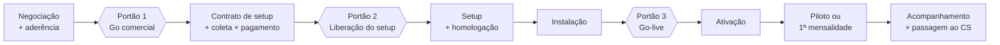

# Plano Pré-pago · 3S Checkout

Processo comercial e operacional para reduzir o tempo de implantação de lojas no 3S Checkout. Ele é a base de um sistema futuro que conecta o **pipeline comercial** ao **pipeline de projetos**.

> **Status:** fase 0, desenho do processo e documentação · **Teste piloto:** em definição com Comercial, Jurídico e Financeiro

---

## O problema

O comercial fecha o contrato, mas a implantação trava. Para configurar e implantar o ponto de venda, a 3S depende de informações do cliente: cardápio, integrações, certificado digital, dados fiscais e particularidades da loja. Essas informações chegam tarde e incompletas, e por isso o ciclo entre a assinatura e a ativação é longo e imprevisível.

## A proposta

Um **plano pré-pago** com três mudanças:

1. **As informações são coletadas antes do setup.** O time de pré-vendas faz a coleta enquanto a negociação avança.
2. **O setup é pago antes de começar**, por meio de um contrato de setup específico, com obrigações e consequências para os dois lados.
3. **Três portões de decisão.** Uma conta só passa para a etapa seguinte quando cumpre todos os critérios.

Em troca do pagamento antecipado, o cliente recebe **agendamento garantido, suporte dedicado e processo presencial**.

## Documentação

| # | Documento | Conteúdo |
|---|---|---|
| 01 | [Contexto e problema](docs/01-contexto-e-problema.md) | Cenário atual, gargalo, objetivos e escopo do teste |
| 02 | [Fluxo do plano pré-pago](docs/02-fluxo.md) | Etapas, responsáveis, cronograma de referência e portões |
| 03 | [Política comercial](docs/03-politica-comercial.md) | Contratos, cobranças, contrapartidas e ofertas |
| 04 | [Pipelines](docs/04-pipelines.md) | Pipeline comercial, pipeline de projetos e como eles se conectam |
| 05 | [Modelo de dados](docs/05-modelo-de-dados.md) | Entidades e relacionamentos do sistema futuro |
| 06 | [Métricas](docs/06-metricas.md) | Indicadores de sucesso do teste e do processo |
| 07 | [Go-to-market](docs/07-go-to-market.md) | Objeções, posicionamento de marca e marketing |
| 08 | [Roadmap](docs/08-roadmap.md) | Do processo manual ao app de pipelines |
| 09 | [Decisões](docs/09-decisoes.md) | Registro das decisões e das questões em aberto |
| 10 | [Glossário](docs/10-glossario.md) | Termos usados no projeto |
| 11 | [Apresentação](docs/11-apresentacao.md) | Link da apresentação oficial e histórico de versões |
| 12 | [Versão de teste](docs/12-versao-de-teste.md) | Como publicar o app na Vercel e roteiro para os testadores |

## Visão de produto

Este repositório começa como documentação de processo. O objetivo é evoluir para uma aplicação no estilo de um CRM, com dois pipelines conectados:

- **Pipeline comercial:** acompanha o deal da qualificação até o setup pago.
- **Pipeline de projetos:** nasce automaticamente quando o deal assina o contrato de setup e acompanha a conta até o go-live e a passagem ao CS.

Os dois compartilham a mesma conta, os portões e o checklist do cliente. Assim, o comercial vê o status da implantação, e o time de projetos vê o que foi negociado.

## Áreas envolvidas

Comercial · Pré-vendas · Jurídico · Financeiro · Projetos · CS · Marketing

## Autor

João · Coordenação de Novos Negócios
