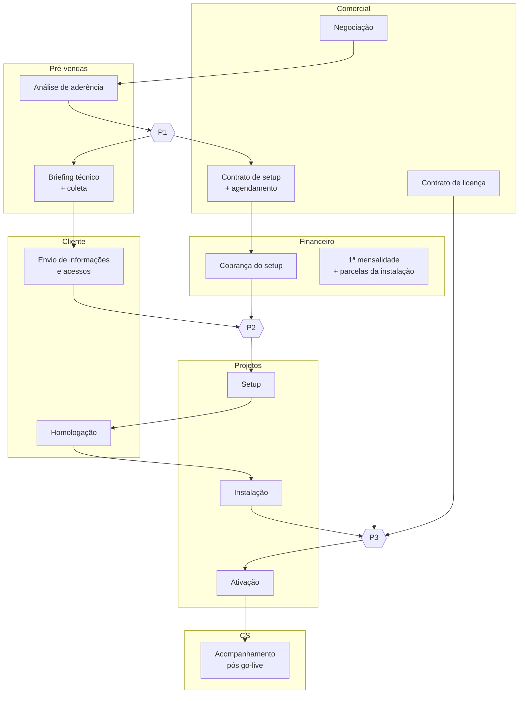
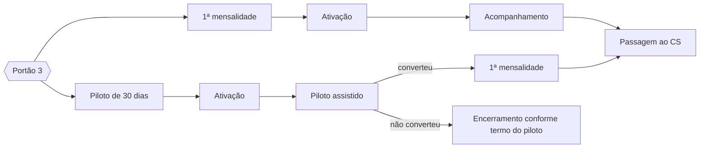

# 02 · Fluxo do plano pré-pago

## Visão geral

## Cronograma de referência

Este é um exemplo para uma operação padrão, em **dias úteis**. O prazo de coleta muda conforme o porte (ver abaixo).

| Etapa | Área | Início | Fim | Observação |
|---|---|---:|---:|---|
| Negociação | Comercial | D1 | D7 | |
| Análise de aderência | Pré-vendas | D3 | D6 | Concluir antes do fim da negociação |
| Briefing técnico + coleta | Pré-vendas | D5 | D12 | Cresce com o porte |
| Envio de informações e acessos | Cliente | D5 | D12 | Responsabilidade do cliente |
| Modelo do contrato de setup | Jurídico | D6 | D8 | Modelo padrão, revisado uma única vez |
| Contrato de setup + agendamento | Comercial | D8 | D10 | |
| Cobrança do setup | Financeiro | D9 | D12 | Emitida depois da assinatura |
| **Portão 2 · Liberação do setup** | | | **D12** | |
| Setup | Projetos | D13 | D19 | |
| Testes e homologação | Cliente | D17 | D19 | Aceite formal |
| Contrato de licença | Comercial | D16 | D23 | |
| Instalação | Projetos | D20 | D23 | Pode ser parcelada nas mensalidades |
| 1ª mensalidade | Financeiro | D20 | D23 | Ou aprovação do piloto |
| **Portão 3 · Go-live** | | | **D23** | |
| Ativação | Projetos | D24 | D25 | |
| Acompanhamento pós go-live | CS | D26 | D30 | Ou piloto assistido de 30 dias corridos |

### Prazo de coleta por porte

| Porte | Prazo de coleta | Efeito no cronograma |
|---|---:|---|
| Até 5 lojas | 5 dias | Referência acima |
| 6 a 20 lojas | 10 dias | Etapas seguintes deslocadas em +5 dias |
| Mais de 20 lojas | 15 dias | Etapas seguintes deslocadas em +10 dias |

> As faixas de porte são uma proposta inicial e precisam ser validadas com pré-vendas e projetos.

## Portões de decisão

Cada portão é um critério de passagem. Se algum item não for cumprido, a conta não avança.

### Portão 1 · Go comercial
- [ ] Aderência técnica aprovada
- [ ] Proposta aceita pelo cliente
- [ ] Porte e prazo de coleta definidos

**Se reprovar:** a negociação volta ou é encerrada.

### Portão 2 · Liberação do setup
- [ ] Contrato de setup assinado
- [ ] Pagamento do setup compensado
- [ ] Checklist do cliente 100% completo

**Se faltar algo:** o setup não começa, e a data reservada pode voltar para a fila.

### Portão 3 · Go-live
- [ ] Homologação aprovada pelo cliente
- [ ] Contrato de licença assinado
- [ ] 1ª mensalidade paga ou piloto aprovado

**Se faltar algo:** a ativação fica suspensa até a pendência ser resolvida.

## Caminhos depois da instalação

## Checklist de informações do cliente

É o anexo do contrato de setup. Ele precisa estar completo para liberar o Portão 2.

| Item | Detalhe |
|---|---|
| Cardápio completo | Itens, preços, modificadores e combos |
| Certificado digital | A1 válido e senha |
| Dados fiscais | CNPJ, inscrição estadual, regime tributário, NCM/CFOP |
| Integrações | Delivery, ERP, TEF, adquirente e credenciais |
| Acessos | Usuários, perfis e permissões |
| Equipamentos | Inventário de PDVs, impressoras e rede |
| Particularidades da loja | Layout, salão, mesas, fluxo de cozinha |
| Responsável do cliente | Ponto focal com poder de decisão e agenda para os testes |

> Lista inicial, a ser validada por pré-vendas e projetos.
