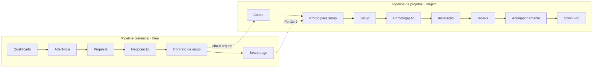

# 04 · Pipelines

O processo é organizado em dois pipelines conectados. Hoje eles servem de referência para o processo manual. No futuro, viram a estrutura do app (ver [Roadmap](08-roadmap.md)).

## Pipeline comercial (Deal)

| Etapa | Critério de entrada | Responsável | Portão |
|---|---|---|---|
| Qualificado | Conta dentro do ICP do teste | Comercial | |
| Aderência | Briefing inicial recebido | Pré-vendas | |
| Proposta | Aderência aprovada | Comercial | |
| Negociação | Proposta enviada | Comercial | P1 na saída |
| Contrato de setup | Proposta aceita | Comercial + Jurídico | |
| **Setup pago** · ganho | Contrato assinado e pagamento compensado | Financeiro | |
| Perdido | Motivo obrigatório | Comercial | |

O deal continua aberto depois do ganho para registrar dois marcos: o **contrato de licença** e a **1ª mensalidade**.

## Pipeline de projetos (Projeto)

| Etapa | Critério de entrada | Responsável | Portão |
|---|---|---|---|
| Coleta | Contrato de setup assinado (criado a partir do deal) | Pré-vendas + Cliente | |
| Pronto para setup | Checklist 100% e setup pago | Projetos | P2 |
| Setup | Data agendada | Projetos | |
| Homologação | Setup concluído | Cliente | |
| Instalação | Homologação aprovada | Projetos | |
| Go-live | Licença assinada e 1ª mensalidade paga, ou piloto aprovado | Projetos | P3 |
| Acompanhamento | Loja ativa | CS | |
| Concluído | Passagem ao CS ou piloto convertido | CS | |
| Bloqueado | Pendência em algum portão | Responsável da pendência | |

## Como os pipelines se conectam

| Evento | Efeito |
|---|---|
| Deal chega a **Contrato de setup** | O projeto é criado em **Coleta**, com o checklist e a data reservada |
| Pagamento do setup compensado | O deal vai para **Setup pago**. Se o checklist estiver completo, o projeto passa no P2 |
| Checklist atrasado | O projeto fica **Bloqueado**, e o comercial recebe alerta para agir junto ao cliente |
| Contrato de licença assinado | O marco é registrado no deal e libera um dos critérios do P3 |
| Projeto em **Go-live** | O deal mostra a conta ativa e começa a contar a recorrência |
| Piloto não converte | O projeto é encerrado e o deal recebe o motivo |

**Princípio:** cada informação é registrada uma única vez e aparece nos dois lados. O comercial vê a saúde da implantação, e projetos vê o que foi vendido e prometido.
