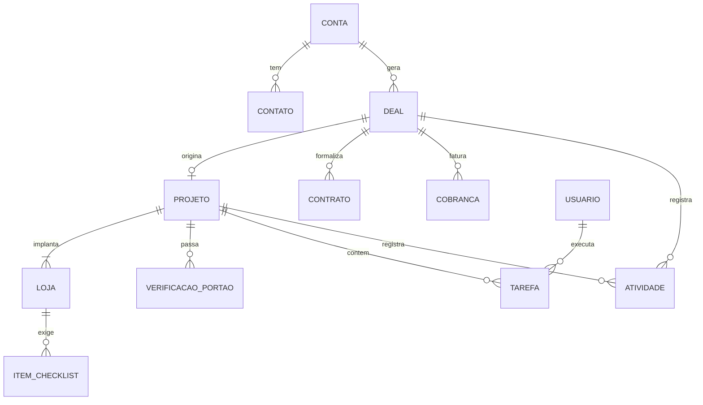

# 05 · Modelo de dados

Primeira versão do modelo de entidades para o app de pipelines. Serve para alinhar o vocabulário, não é um esquema final.

## Entidades

| Entidade | Descrição | Campos principais |
|---|---|---|
| **Conta** | A rede ou empresa cliente | nome, CNPJ, segmento, porte, nº de lojas |
| **Contato** | Pessoas da conta | nome, papel (decisor, ponto focal, TI), e-mail |
| **Deal** | Oportunidade comercial | etapa, valor do setup, valor da instalação, mensalidade, faixa de complexidade, caminho (piloto ou mensalidade), dono, motivo de perda |
| **Projeto** | A implantação gerada pelo deal | etapa, data reservada, data de go-live, status (no prazo, em risco, bloqueado) |
| **Loja** | Cada unidade implantada | nome, endereço, etapa, data de ativação |
| **Item do checklist** | Informação exigida do cliente | tipo, status (pendente, recebido, validado), prazo, data de recebimento |
| **Verificação de portão** | Registro da passagem em P1, P2 ou P3 | portão, data, aprovado, pendências |
| **Contrato** | Contrato de setup, de licença ou termo de piloto | tipo, status, data de assinatura |
| **Cobrança** | Setup, parcela de instalação ou mensalidade | tipo, valor, vencimento, data de pagamento |
| **Tarefa** | Trabalho operacional | área, responsável, prazo, status |
| **Atividade** | Histórico de eventos (log) | tipo, autor, data, descrição |
| **Usuário** | Pessoas da 3S | nome, área (comercial, pré-vendas, jurídico, financeiro, projetos, CS) |

## Regras de negócio

- Um deal gera **no máximo um** projeto. O projeto pode ter várias lojas.
- O portão P2 só é aprovado com contrato de setup assinado, cobrança de setup paga e todos os itens obrigatórios do checklist validados.
- O portão P3 só é aprovado com homologação aceita, contrato de licença assinado e 1ª mensalidade paga (ou termo de piloto assinado).
- O prazo de setup começa a contar na data em que o último item do checklist é validado.
- As parcelas da instalação são cobranças ligadas às primeiras mensalidades e vencem antecipadamente se o cliente cancelar.
