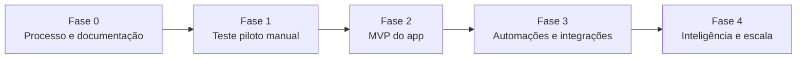

# 08 · Roadmap

## Fase 0 · Processo e documentação · *em andamento*
- [x] Desenho do fluxo e dos portões
- [x] Primeira versão da política comercial
- [x] Validação inicial com o comercial (reunião de 18/11)
- [ ] Validação com Jurídico e Financeiro
- [ ] Definição do ICP, da tabela de setup e das regras de parcelamento da instalação

## Fase 1 · Teste piloto manual
- Rodar o processo com um grupo restrito de contas.
- Acompanhar os pipelines numa ferramenta simples (planilha ou CRM atual).
- Medir as métricas de [06 · Métricas](06-metricas.md) e comparar com a base.
- Registrar o que muda no processo antes de construir o sistema.

## Fase 2 · MVP do app
O objetivo é um app no estilo de um CRM, com os dois pipelines conectados.

- Kanban do pipeline comercial e do pipeline de projetos
- Criação automática do projeto quando o deal chega a Contrato de setup
- Checklist do cliente por loja, com status e prazos
- Verificação dos portões com bloqueio automático
- Timeline única de atividades por conta
- Visões por área: comercial, pré-vendas, projetos, financeiro

## Fase 3 · Automações e integrações
- Portal do cliente para envio de informações e acompanhamento do cronograma
- Assinatura eletrônica dos contratos
- Integração com o financeiro: status de pagamento atualizado automaticamente no deal
- Alertas de prazo e de bloqueio para os responsáveis
- Agenda de capacidade do time de projetos

## Fase 4 · Inteligência e escala
- Dashboards de tempo por etapa e gargalos
- Previsão de data de go-live a partir do histórico
- Score de risco por conta (checklist atrasado, homologação demorada)
- Expansão do modelo para toda a base e para redes maiores
